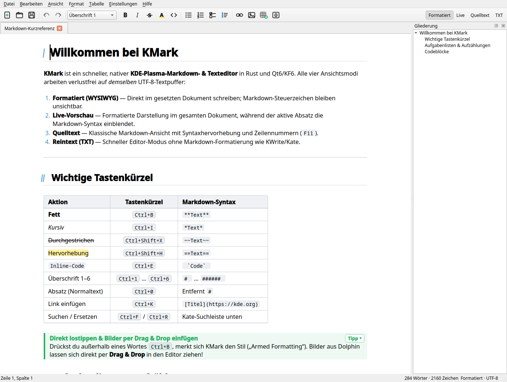
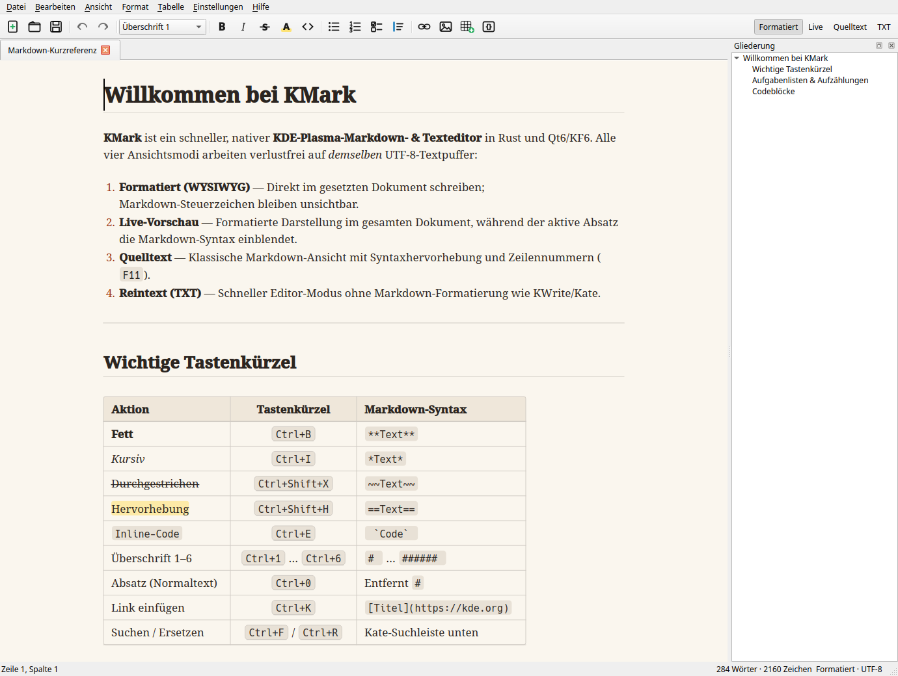

# KMark — Native WYSIWYG Markdown & Text Editor for KDE Plasma

[](LICENSE)
[-orange.svg)](Cargo.toml)
[](CMakeLists.txt)

**KMark** is a fast, native WYSIWYG Markdown and plain-text editor for **Linux & KDE Plasma**, combining the immediate typographic editing experience of *MDNote* with the native desktop conventions, menus, shortcuts, and Breeze styling of **KDE Kate / KWrite**.

KMark uses a **Single-Buffer Projected Editor** architecture written in **safe Rust (`unsafe_code = "forbid"`)** across its core crates, paired with a thin native **C++20 Qt6 / KDE Frameworks 6 (`KXmlGuiWindow` + `QPainter`)** shell.



*Above: Default **System (KDE Breeze)** preset with slanted heading bars · Below: Built-in **Classic ("Klassisch")** preset with warm paper background, serif typography, and clean book-style headings:*



---

## Highlights

- **Four Seamless View Modes over a Single UTF-8 `Rope` Buffer** (zero lossy round-trip conversions):
  1. **Formatted (`WYSIWYG`)** — Type directly inside the typeset document; Markdown markers (`**`, `*`, `#`, `[…](…)`) stay hidden while slanted left-margin `H1`–`H6` bars indicate heading levels.
  2. **Live Preview** — Full document formatted, while the active block under the caret reveals its underlying Markdown syntax.
  3. **Markdown Source** — Monospace syntax highlighting with optional line numbers (`F11`).
  4. **Plain Text (`TXT`)** — Distraction-free plain-text editor mode (activated automatically for `.txt` files).
- **True 2D GFM Table Grid with Contextual Table Toolbar & Smart Column Balancing**:
  - Direct in-cell editing mapped to exact byte ranges, `min-content`-aware column sizing (preventing narrow single-word columns from squeezing mid-word next to wide neighbors), per-column alignment (`Left`, `Center`, `Right`), `Tab` / `Shift+Tab` cell navigation, automatic row creation at table end, and row/column insertion & deletion.
  - **Contextual Table Toolbar**: Moving the caret inside any table automatically reveals inline row, column, and column-alignment toolbar actions (`Insert Row Above/Below`, `Delete Row`, `Insert Column Left/Right`, `Delete Column`, `Align Left/Center/Right`).
- **Unified Settings Dialog, Appearance Presets & Persistent State**:
  - Configure body & monospace fonts, font size, line spacing, max column width, **Heading Indicators** (*Slanted Bars*, *`#` Hash*, or *None*), editor view toggles, and 8 custom editor colors in a unified KDE **Settings Dialog** (`Settings -> Configure KMark…`, `Ctrl+Shift+,`) with a live WYSIWYG preview card.
  - Ships with **6 curated Appearance Presets** (*System (KDE Breeze)*, *Modern*, *Classic*, *Calm*, *Dark (Night Studio)*, *Technical*) plus custom user-saved presets selectable directly from `Settings -> Appearance Presets`.
  - Automatically persists appearance, editor options, recent files, last folder root, and window/dock state across restarts.
- **Clickable Code Block Language & Callout Type Selectors + Interactive Task Lists**:
  - Every fenced code block displays a clickable language badge (`rust ▾` / `Code ▾`) in the top-right corner during Formatted and Live Preview modes (also accessible via `Format -> Code Block Language…` or `Ctrl+Alt+L`).
  - Every Callout / GFM Alert (`[!NOTE]`, `[!TIP]`, `[!IMPORTANT]`, `[!WARNING]`, `[!CAUTION]`) displays a clickable top-right type badge (`Note ▾` / `Hinweis ▾`) to switch Callout types in-place or convert back to a plain blockquote.
  - Task list checkboxes (`- [ ]` / `- [x]`) toggle directly on click.
- **Inline Images with Captions, Relative Sizing & Context Menu**:
  - Drag & drop image files (`.png`, `.jpg`, `.svg`, `.webp`, `.gif`, `.avif`) from Dolphin or paste screenshots directly from the clipboard to insert clean relative paths and render local images inline.
  - Supports centered italic **image captions** (``) and **relative percentage widths** (`{width=50%}`), editable via a right-click **Image Context Menu** (*Add/Edit Caption*, *Replace Image*, *Size: Automatic / 25%–100% / Custom %*).
- **Armed Formatting & Smart Structural Editing**:
  - Pressing `Ctrl+B` or `Ctrl+I` outside a word arms the style without littering empty `****` markers into the buffer until you actually type.
  - `Enter` continues bullet lists, numbered lists (`1.` -> `2.`), task lists, and blockquotes — and exits cleanly on a second `Enter` on an empty item.
- **Native KDE Plasma Shell (`English` & `Deutsch`)**:
  - Integrates with KDE Frameworks 6 (`KXmlGuiWindow`, Breeze Light & Dark `QPalette` tracking, standard KDE shortcuts) and automatically detects the system locale (`KLocalizedString` / `LANGUAGE` / `LANG`), currently shipping built-in `English` and `German` UI strings (`I18n.h`).
  - Built-in **Markdown Quick Reference** (`F1`) and **Markdown Complete Reference** (`Shift+F1`).
  - Persistent **Open Recent** (`File -> Open Recent`) menu, multi-tab crash recovery (`~/.local/state/kmark/recovery/`), dockable *Outline* (`F9`) & *Folder Tree* (`F7`) with parent/home navigation and a PhpStorm-style **Select Opened File** action button, Kate-style bottom Find/Replace bar (`Ctrl+F` / `Ctrl+R`, RegEx), HTML5 export, and PDF/CUPS print preview.
- **Fast Virtualized Editing on Large Documents**:
  - Persistent Copy-on-Write B-tree `Rope` (`O(log N)`), exact diff-window incremental block & outline updates, persistent `BlockHeightCache` scroll virtualization, single-pass `QTextLayout` run shaping, and cached cursor-blink frames (`cargo run --release -p kmark-cli -- bench` headless `FallbackMeasurer`, 25-run medians: **~0.35 ms** edit+layout / **~0.26 ms** scroll frame at **6,000 lines**; **~0.60 ms** edit+layout / **~0.42 ms** scroll frame / **~1.3 ms** cold first frame at **60,000 lines**; **~0.86 ms** edit+layout / **~0.54 ms** scroll frame / **~1.8 ms** cold first frame at **100,000 lines**; GUI frames add cached `QTextLayout` shaping and `QPainter` drawing for visible runs only).

## Status

Beta. Developed and tested on Fedora 44 with KDE Plasma 6 (KWin 6.8).

## Architectural Trade-offs & Known Limitations

KMark renders directly from a single UTF-8 `Rope` onto a custom `QPainter` `DisplayList` rather than converting Markdown into a `QTextDocument` or embedding `KTextEditor`. This avoids lossy Markdown <-> AST round-trips and makes switching between **Formatted (`WYSIWYG`)**, **Live Preview**, **Markdown Source**, and **Plain Text** an instant `O(1)` projection change, at the cost of not inheriting Qt's rich-text widget subsystems automatically:

- **Accessibility (`QAccessible`)**: Screen-reader / assistive-technology exposure for the custom canvas viewport is not yet implemented.
- **BiDi / RTL & Complex Script Shaping**: Left-to-right Latin, CJK, and emoji grapheme clusters are supported via UTF-16-aligned `QTextLayout` measurement, but right-to-left (`RTL`) bidirectional paragraph layout is not yet implemented.
- **Spell Checking**: KDE `Sonnet` inline spell-checking is not yet integrated.
- **Translations (`i18n`)**: The UI currently ships compiled-in `English` and `German` strings (`qt-shell/src/I18n.h`); full GNU gettext `.po` / `ki18n` catalog extraction for community translations is planned.

---

## Layered Architecture (`L0` -> `L5`)

```text
crates/
  buffer      L0  Persistent Copy-on-Write Rope, auto-encoding (UTF-8/UTF-16/CP1252), atomic symlink-safe save, Undo/Redo
  syntax      L1  Exact byte-offset CommonMark/GFM block parser, diff-window incremental reparse, 2D table AST, HTML5 export
  layout      L2  Modular single-buffer layout engine (context, inline, 2D table, hit-test), BlockHeightCache, DisplayList
  engine      L3  Multi-tab session, command registry, armed formatting, RegEx search/replace, multi-tab crash recovery
  ffi         L4  Panic-safe, poison-guarded C ABI (`kmark_ffi.h`) with single-pass QTextLayout & image callbacks
apps/
  kmark-cli   --  Headless CLI (`info`, `outline`, `html`, `commands`, `bench`)
qt-shell/     L5  Native C++20 Qt6 / KDE Frameworks 6 GUI (`MainWindow`, `EditorViewport`, `SettingsDialog`, `AppSettings`)
```

---

## Building & Local Installation

### Prerequisites

- **Rust** toolchain (`1.90+`, `cargo`)
- **CMake** (`3.22+`), C++20 compiler (`g++` or `clang++`)
- **Qt6** (`Core`, `Gui`, `Widgets`, `PrintSupport`) and optional **KDE Frameworks 6** (`XmlGui`, `ConfigWidgets`, `CoreAddons`, `I18n`)

**Fedora / RHEL / openSUSE:**
```bash
sudo dnf install cmake gcc-c++ cargo rust qt6-qtbase-devel \
    kf6-kxmlgui-devel kf6-kconfigwidgets-devel kf6-kcoreaddons-devel kf6-ki18n-devel
```

**Debian / Ubuntu / KDE neon:**
```bash
sudo apt install cmake g++ cargo rustc qt6-base-dev \
    libkf6xmlgui-dev libkf6configwidgets-dev libkf6coreaddons-dev libkf6i18n-dev
```

*(Note: If `kf6-*-dev` packages are not installed, CMake automatically falls back to pure Qt6 mode.)*

### Quick Local User Install (`~/.local`)

Install `kmark`, `kmark-cli`, the scalable SVG icon, `.desktop` launcher, AppStream metadata, and `kmarkui.rc` into `~/.local` without root privileges:

```bash
./scripts/install-local.sh
```

To remove the local installation cleanly:

```bash
./scripts/uninstall-local.sh
```

### Manual CMake Build & Tests

```bash
cargo test --workspace
cmake -B build -DCMAKE_BUILD_TYPE=Release
cmake --build build -j
./build/kmark
```

---

## Building Distribution Packages (`.deb`, `.rpm`, `.tar.gz`)

Build release packages locally via CPack / helper scripts:

```bash
./scripts/build-packages.sh
```

Generated artifacts are placed in `dist/` (`kmark-0.1.0-linux-x86_64.tar.gz`, `.deb`, `.rpm`, and `SHA256SUMS`).

---

## About the development

KMark was developed with extensive help from AI. The code, the tests and the documentation were written by Google's Gemini and Anthropic's Claude under my direction. Requirements, design decisions, review and all tests are my own.

## License

Copyright (C) 2026 KMark Contributors.
Licensed under the **GNU General Public License v3.0 or later** ([`GPL-3.0-or-later`](LICENSE)).
